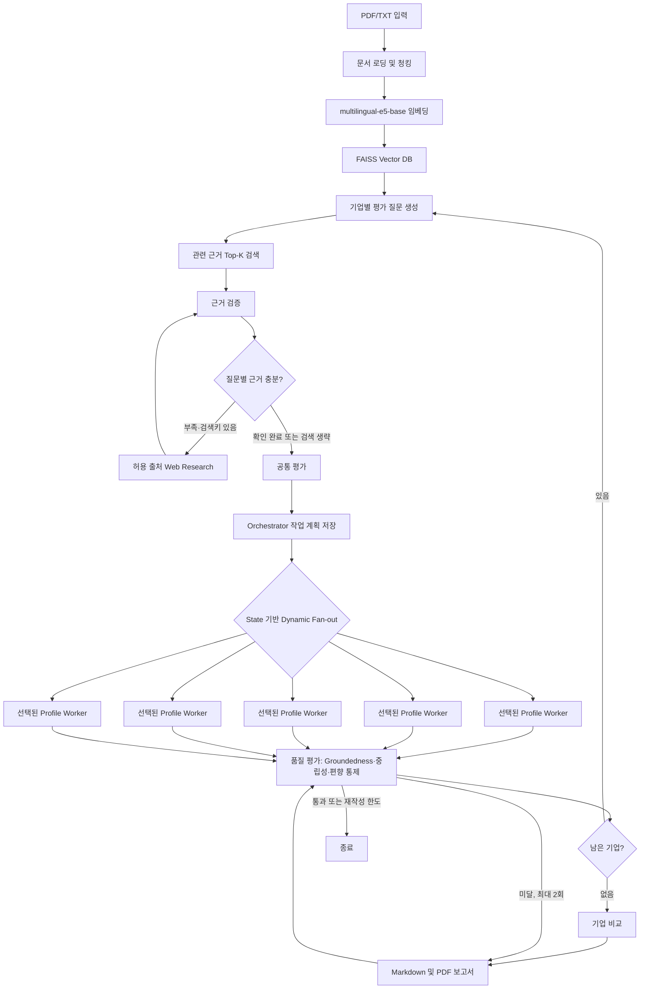

# Battery Intelligence 스타트업 투자평가 Multi-Agent RAG

> SKALA 4기 · 울산 3반 · 4조  
> LangGraph 기반 Multi-Agent + Agentic RAG 투자평가 시스템

## 1. 프로젝트 한 줄 소개

배터리 AI 스타트업의 공개자료를 RAG로 검색하고, Orchestrator가 근거 상태에 따라 평가 작업을 계획한 뒤 **기술·안정·성장·균형·사업성 투자 관점**의 Worker를 병렬 실행해 투자보고서를 생성합니다.

이 프로젝트의 핵심은 단순히 LLM에게 투자 여부를 질문하는 것이 아닙니다.

1. 평가에 사용할 근거를 먼저 수집합니다.
2. 공통 기준과 투자자 유형별 기준을 분리해 평가합니다.
3. 근거가 부족하면 억지로 점수를 만들지 않고 `판단 유보`로 남깁니다.
4. 로컬 근거가 부족한 질문은 허용 출처 정책에 따라 웹 검색하고, 보고서를 Groundedness·중립성·편향 통제 기준으로 평가합니다.
5. 최종 결과를 차트 포함 PDF와 Markdown으로 출력합니다.

### 적용 패턴과 기술 범위

- **Agent Pattern**: Orchestrator–Workers를 선택했습니다. 계획 노드가 검증된 근거와 공통 평가 결과를 바탕으로 필요한 프로필 작업을 만들고, 해당 Worker를 동적으로 병렬 실행해 불필요한 고정 순차 호출을 줄입니다.
- **동적 처리**: 공통 채점 결과의 근거 충족률과 핵심 미확인 항목에 따라 웹 검색 여부를 조건 분기합니다. 검색 후에는 근거를 다시 검증·채점하고, Worker 실행 목록도 State에 기록된 계획에 따라 정합니다. 보고서 품질 미달 시에는 최대 2회 재작성합니다.

이 프로젝트는 SW와 HW 기술을 서로 경쟁시켜 우열을 결정하는 과제가 아니라 **배터리 AI 스타트업 투자평가**입니다. 템플릿의 SW/HW 선정 항목은 다음처럼 이 프로젝트의 평가 대상과 적용 맥락으로 구체화했습니다.

| 구분 | 선정 기술·평가 범위 | 선정 이유 |
|---|---|---|
| SW | 배터리 진단·분석 및 SOH/RUL 예측 소프트웨어 | 배터리 AI 스타트업의 핵심 제품과 기술 역량을 평가하기 위해서입니다. |
| HW | 별도 HW 기업 비교는 하지 않으며, BMS·ESS를 SW 연동·적용 맥락으로 다룹니다. | 실제 배터리 시스템과의 연동·적용 가능성을 평가하되 하드웨어 자체의 성능 비교로 범위를 넓히지 않기 위해서입니다. |

---

## 2. 문제 정의

배터리 AI 기업은 다음과 같은 이유로 직접 비교하기 어렵습니다.

- SOC·SOH·RUL 등 기업마다 제시하는 기술지표가 다릅니다.
- 같은 정확도라도 시험 조건, 배터리 화학계, 데이터 규모가 다릅니다.
- 회사의 홍보자료와 독립 검증자료가 함께 검색됩니다.
- 매출, 계약, 고객 유지율처럼 비상장기업이 공개하지 않는 정보가 많습니다.
- 기술력이 높더라도 안정성 또는 사업성이 부족할 수 있습니다.

따라서 하나의 종합 프롬프트가 모든 판단을 수행하면 관점이 섞이고, 공개되지 않은 정보를 추정할 위험이 있습니다. 근거 수집과 투자 판단을 분리하고, Orchestrator가 실제로 확인된 영역을 보고 필요한 전문 Agent 작업을 동적으로 계획합니다.

---

## 3. 핵심 차별점

### 차별점 1. 하나의 점수가 아니라 5개의 투자 관점

모든 Agent가 같은 근거를 사용하지만 중요하게 보는 기준은 다릅니다.

| Agent | 핵심 관점 | 주요 확인 내용 |
|---|---|---|
| 기술중심형 | 기술의 실제 검증 수준 | 예측 성능, 독립 검증, 데이터 경쟁력, BMS/ESS 연동, 일반화, 기술 방어력 |
| 안정형 | 손실 가능성과 지속 가능성 | 안전·규제, 재무 지속성, 데이터 이용 권한, 제조물책임 |
| 성장형 | 성장 속도와 확장 가능성 | 시장 성장률, 유료 전환, ARR 성장, 확장성, 데이터 네트워크 효과 |
| 균형형 | 영역 간 연결성 | 기술-시장 적합성, 시장-수익 전환성, 기술-리스크 양립성, 팀-사업 실행력 |
| 사업성중심형 | 실제 돈을 버는 구조 | 수익모델, 고객·계약, 상용화, 팀의 사업 실행력 |

이 구조를 통해 “기술은 좋지만 수익모델이 약한 기업”과 “성장은 빠르지만 안전·규제 위험이 큰 기업”을 서로 다른 관점으로 설명할 수 있습니다.

### 차별점 2. 공통 평가 70% + 유형별 독립 평가 30%

각 Agent의 최종점수는 다음 구조를 사용합니다.

```text
공통 프로필 점수 = Σ(기술·시장·재무·리스크·팀 점수 × Agent별 영역 가중치)

Agent 최종점수 = 공통 프로필 점수 × 70%
                + Agent별 독립 세부점수 × 30%
```

- **공통 70%**는 모든 Agent가 기업의 기본적인 투자 매력을 같은 틀에서 평가하게 합니다.
- **유형별 30%**는 각 Agent의 목적에 맞는 별도 파라미터로 계산합니다.
- 유형별 30%는 공통 점수를 다시 복사하거나 재가중한 값이 아니라, 각 관점에 맞게 독립적으로 평가합니다.

예를 들어 성장형 Agent의 30%는 시장 성장, 고객 전환, 매출 성장, 확장성, 데이터 네트워크 효과, 실행역량으로 구성됩니다. 기술형 Agent는 예측 성능과 검증 신뢰성을 중심으로 별도의 기술 점수를 만듭니다.

### 차별점 3. 근거 부족을 0점으로 처리하지 않음

공개자료가 없다는 것은 성과가 나쁘다는 뜻이 아닙니다. Profile Agent의 근거 검사에서 미확인 항목을 0점으로 바꾸지 않습니다.

| 근거 상태 | 처리 방식 |
|---|---|
| 충분한 직접 근거 | 항목 평가 및 점수 산출 |
| 일부 근거만 확인 | 항목별 상태 기록, 종합점수 산출 조건 확인 |
| 핵심 지표 미확인 | `weighted_score=None`, 판단 유보 |
| 평가 대상이 아님 | `NOT_APPLICABLE`, 충족률 분모에서 제외 |
| 상충 근거 존재 | 반대 근거로 기록하고 추가 실사 요청 |

판단 유보가 발생해도 Graph를 중단하지 않습니다. 해당 Agent의 점수는 미산출로 유지하고, 부족한 근거와 추가 실사 질문을 최종 보고서의 **근거 부족 및 판단 유보** 항목에 표시합니다.

---

## 4. 전체 시스템 구조



### 기술별 역할

| 기술 | 역할 |
|---|---|
| LangChain | 문서 로딩, 청킹, 임베딩, FAISS 검색, 프롬프트 및 구조화 출력 |
| LangGraph | State 관리, 근거 기반 조건 분기, Orchestrator 계획, 동적 병렬 실행, 재개 가능한 실행 체크포인트 |
| Pydantic | Evidence, ProfileResult, CompanyResult 등 결과 스키마 검증 |
| FAISS | 평가 질문과 관련된 문서 청크 검색 |
| ReportLab / WeasyPrint | 차트 및 PDF 투자보고서 출력 |

### 실제 코드로 보는 LangChain

#### 1. 문서 로딩과 청킹

[`src/rag/ingest.py`](src/rag/ingest.py)에서 LangChain Loader로 PDF/TXT를 읽고 `RecursiveCharacterTextSplitter`로 검색 단위를 만듭니다.

```python
if file.suffix.lower() == ".pdf":
    loader = PyPDFLoader(str(file))
elif file.suffix.lower() == ".txt":
    loader = TextLoader(str(file), encoding="utf-8")

loaded_docs = loader.load()

text_splitter = RecursiveCharacterTextSplitter(
    chunk_size=500,
    chunk_overlap=50,
    separators=["\n\n", "\n", ".", " ", ""],
)
split_docs = text_splitter.split_documents(docs)
```

문서의 근거 등급은 자료 본문에서 추출한 URL의 도메인을 `configs/source_policy.yaml`과 대조해 정합니다. URL이 없거나 허용목록에 없거나 여러 티어가 섞여 있으면 `U`(미확인)로 두고 평가 근거로 통과시키지 않습니다. 벡터 인덱스가 없을 때 예시 기업 정보를 대신 채우지 않으며, 먼저 실제 PDF/TXT 자료를 적재해야 합니다.

발표 포인트는 “PDF 전체를 LLM에 넣는 것이 아니라, 의미 검색이 가능한 500자 단위 청크로 나눈다”는 것입니다. 50자 overlap은 청크 경계에서 문맥이 끊기는 문제를 줄입니다.

#### 2. 임베딩과 FAISS 검색

[`src/rag/vector_store.py`](src/rag/vector_store.py)에서 다국어 E5 임베딩을 만들고, 질문과 의미적으로 가까운 문서를 검색합니다.

```python
def get_embeddings():
    return HuggingFaceEmbeddings(
        model_name="intfloat/multilingual-e5-base",
        model_kwargs={"device": "cpu"},
        encode_kwargs={"normalize_embeddings": True},
    )

results = db.similarity_search_with_score(query, k=k)
```

단순 키워드 일치가 아니라 질문과 청크를 벡터로 변환해 의미적으로 가까운 근거를 가져옵니다. 검색 결과는 이후 Agent가 사용하는 `Evidence` 객체로 변환됩니다.

#### 3. 프롬프트와 구조화 출력

성장형 Agent는 LangChain의 `ChatPromptTemplate`과 Pydantic 구조화 출력을 연결합니다.

```python
growth_scoring_llm = llm.with_structured_output(GrowthCustomEvaluation)

growth_scoring_prompt = ChatPromptTemplate.from_messages([
    ("system", "제공된 검증 근거만 사용해 성장형 지표를 평가하세요."),
    ("user", "기업명: {company_name}\n근거: {evidence_text}"),
])

growth_evaluation = (
    growth_scoring_prompt | growth_scoring_llm
).invoke({
    "company_name": company_name,
    "evidence_text": evidence_text,
})
```

`prompt | llm`은 LangChain Runnable 파이프라인입니다. 자유 형식 문자열이 아니라 `GrowthCustomEvaluation` 형태로 결과를 받아 상태, 점수, 근거 ID와 미확인 항목을 안정적으로 후속 노드에 전달합니다.

### 실제 코드로 보는 LangGraph

#### 1. State와 reducer

[`src/schemas.py`](src/schemas.py)의 State는 전체 Graph가 공유하는 데이터 계약입니다.

```python
class InvestmentAgentState(TypedDict):
    current_company: Optional[Company]
    validated_evidence: List[Evidence]
    worker_tasks: List[WorkerTask]
    web_research_attempts: int
    domain_scores: Dict[Domain, float]
    profile_results: Annotated[List[ProfileResult], reset_or_add]
    company_results: Annotated[List[CompanyResult], operator.add]
    final_comparison: Optional[ComparisonResult]
    report_quality: Optional[ReportQuality]
    report_revision_count: int
    trace_id: str
```

각 노드는 필요한 필드만 반환합니다. 작업 계획과 재개에 필요한 제어 상태를 근거·결과 payload와 구분합니다. `trace_id`는 LangSmith 실행 메타데이터와 연결되고 `MemorySaver`는 같은 프로세스에서 실행을 이어가도록 체크포인트를 보관합니다. 체크포인트는 현재 메모리 기반이므로 프로세스 종료 뒤 복구하려면 영속 저장소가 필요합니다. 전체 근거 청크를 State에 보관하면 메모리 사용량이 커지므로 운영 시에는 문서 ID와 외부 저장 위치를 기록하는 편이 적합합니다.

State Schema 설계 시 고려한 항목은 다음과 같습니다.

| 항목 | 설계 반영 |
|---|---|
| 제어 vs 페이로드 분리 | `current_index`, `worker_tasks`, 재시도·재작성 횟수는 제어 상태로, `validated_evidence`, 점수, 보고서 등은 작업 데이터로 관리합니다. |
| 관측성 위치 | 노드별 실행과 LLM 호출·입출력은 LangSmith 트레이스에서 관찰하고, 라우팅과 재작업 판단 근거도 해당 실행에서 확인합니다. |
| 지속성 비용 | `MemorySaver` 체크포인트는 프로세스 메모리에 저장됩니다. 장기 보존이나 프로세스 재시작 후 복구에는 영속 체크포인터 저장소가 필요합니다. |
| 상관 | 실행마다 생성한 `trace_id`를 LangSmith `metadata`와 체크포인터의 `thread_id`에 함께 전달합니다. |
| 재개/복구 | 같은 `thread_id`로 체크포인트를 이어갈 수 있지만, 현재 메모리 저장 방식은 프로세스 종료 후 복구를 보장하지 않습니다. |
| 동시 처리 | 계획된 `worker_tasks`를 `Send`로 병렬 실행하고, `profile_results` reducer로 결과를 합칩니다. |
| 종료 보장 | 웹 검색은 최대 1회, 보고서 재작성은 최대 2회로 제한하고, 처리할 기업이 끝나면 비교·보고서 생성으로 종료합니다. |

#### 2. Orchestrator 계획 후 `Send`로 동적 Fan-out

[`src/graph.py`](src/graph.py)의 `route_to_profiles()`가 프로필마다 하나의 `Send`를 만듭니다.

```python
def plan_worker_tasks(state):
    # 검증된 영역과 profiles.yaml 가중치를 바탕으로 Worker 목록을 State에 저장
    return {"worker_tasks": planned_tasks}

def route_to_profiles(state):
    return [
        Send("profile_agent", {
            "profile_name": task.profile_name,
            "validated_evidence": state["validated_evidence"],
            "domain_scores": state["domain_scores"],
        })
        for task in state["worker_tasks"]
    ]
```

Orchestrator가 State에 기록한 작업만 `Send`합니다. 어떤 Worker를 실행할지는 평가 대상과 확보된 근거 영역에 따라 달라집니다. 결과는 `profile_results` reducer로 모입니다.

#### 3. 조건 분기와 기업 반복

```python
workflow.add_conditional_edges(
    "plan_worker_tasks",
    route_to_profiles,
    ["profile_agent"],
)

workflow.add_conditional_edges(
    "save_company_result",
    route_next_company,
    {
        "select_company": "select_company",
        "compare_companies": "compare_companies",
    },
)
```

첫 번째 조건부 edge는 State에 계획된 Worker만 병렬 실행합니다. 두 번째 조건부 edge는 기업 반복을 제어합니다. 근거 커버리지가 기준보다 낮으면 Tavily 검색을 한 번 실행한 뒤 같은 검증 노드로 돌아옵니다.

---

## 5. RAG 파이프라인

### 문서 처리

```text
data/raw 문서
→ PDF/TXT 로딩
→ 500자 단위 청킹, 50자 overlap
→ intfloat/multilingual-e5-base 임베딩
→ FAISS 인덱스 저장
```

`multilingual-e5-base`는 한국어와 영문이 혼합된 기업·시장 자료를 로컬 CPU 환경에서도 처리할 수 있어 선택했습니다. 임베딩을 정규화하여 의미 기반 검색의 일관성을 확보했습니다.

| 설정 | 실제 적용값 |
|---|---|
| 제공 모델 | Hugging Face `intfloat/multilingual-e5-base` |
| LangChain 클래스 | `langchain_community.embeddings.HuggingFaceEmbeddings` |
| 실행 장치 | CPU |
| 벡터 정규화 | `normalize_embeddings=True` |
| Vector Store | FAISS |
| 검색 방식 | `similarity_search_with_score` |

OpenAI는 투자평가와 구조화 출력에 사용하는 LLM이며, 문서 임베딩에는 사용하지 않습니다. 즉 역할은 다음과 같이 구분됩니다.

```text
문서 임베딩·검색: multilingual-e5-base + FAISS
투자평가·구조화 출력: OpenAI gpt-4o-mini
```

### 근거 중심 평가

검색된 자료는 `Evidence` 객체로 변환됩니다.

```text
item_id          평가항목 ID
content          검색된 원문 청크
source_id        출처 식별자
evidence_grade   근거 등급
is_direct        대상 기업과의 직접 관련 여부
```

Agent는 입력된 근거만 사용하도록 제한되며, 인용한 문장이 실제 검색 청크에 존재하는지도 확인합니다. 확인되지 않은 정보는 `unknown_items`와 `due_diligence_questions`로 분리합니다.

---

## 6. LangGraph 설계 포인트

### State 기반 연결

`InvestmentAgentState`가 기업, 질문, 검색 근거, 공통 점수, Agent 결과와 보고서를 단계별로 전달합니다.

### 병렬 Agent 실행

Orchestrator가 확인된 근거 영역과 프로필별 가중치를 보고 `WorkerTask` 목록을 State에 저장합니다. `Send`는 이 목록에 포함된 Worker만 병렬 실행하며, 각 결과는 reducer를 통해 `profile_results`에 누적됩니다.

### 근거 부족 시 외부 검색

로컬 청크 개수가 아니라, 공통 채점에서 실제 인용 검증까지 통과한 항목을 기준으로 판단합니다. 채점 커버리지가 75% 미만이거나 사업성·성장·안정형의 핵심 항목(`fin_01`, `fin_02`, `team_01`, `mkt_01`, `rsk_01`, `rsk_02`)이 미채점이면 `TAVILY_API_KEY`가 설정된 경우 해당 누락 항목만 최대 1회 외부 검색합니다. 검색 뒤에는 같은 검증·채점 단계를 다시 거칩니다. 검색 결과는 [`configs/source_policy.yaml`](configs/source_policy.yaml)의 Tier A/B/C 허용 도메인으로 다시 필터링합니다. 개인 블로그·출처 불명 페이지는 허용목록에 포함되지 않습니다. 기업 공식 자료는 제품·투자유치 등 사실 확인에 사용하며, 우월성 주장은 독립 출처와 함께 검토하도록 품질 심사 프롬프트에서 다룹니다.

### 보고서 품질 평가

보고서 생성 뒤 품질 Judge가 아래 세 항목만 평가합니다. 관점 커버리지는 평가하지 않습니다.

| 항목 | 확인 내용 |
|---|---|
| Groundedness | 핵심 주장이 검증 근거로 뒷받침되고 출처에 추적되는가 |
| 중립성 | 회사 주장과 독립 근거를 구분하고 단정적 우열 표현을 피하는가 |
| 편향 통제 | 우호·비우호 근거의 선택적 누락이나 홍보 문구의 무비판적 반복이 없는가 |

미달 시 피드백을 반영해 보고서를 다시 만들며, 재작성은 최대 2회입니다.

### 기업 반복

한 기업의 5개 평가가 끝나면 결과를 저장하고 다음 기업으로 돌아갑니다. 모든 기업이 끝난 뒤에만 기업 비교와 보고서 생성을 수행합니다.

### 판단 유보의 전파

어떤 Agent가 근거 부족으로 점수를 만들지 못하더라도 예외로 종료하지 않습니다.

```text
Agent 판단 유보
→ ProfileResult(weighted_score=None)
→ 기업 종합 단계에서 미산출 Agent 확인
→ 최종 판정 '근거 부족 판단 유보'
→ 보고서에 부족 근거와 추가 요청 자료 표시
```

높은 일부 점수가 근거 부족 판정을 덮어쓰지 못하도록 한 것이 중요한 설계 포인트입니다.

---

## 7. 주요 데이터 모델

```python
class ProfileResult(BaseModel):
    profile_name: str
    weighted_score: Optional[float]
    decision: Optional[FinalDecision]
    evidence_coverage: Optional[float]
    supporting_evidence_ids: List[str]
    contrary_evidence_ids: List[str]
    unknown_items: List[str]
    recommendation: str
    due_diligence_questions: List[str]
```

`weighted_score`를 `Optional`로 설계해 점수 없음과 0점을 구분합니다. 이 값은 종합 단계와 보고서까지 그대로 유지됩니다.

---

## 8. 투자 보고서 핵심 포인트

최종 보고서는 점수만 보여주는 결과표가 아니라, 투자자가 다음 행동을 결정할 수 있는 자료를 목표로 합니다.

1. 기업별 공통 영역점수와 산출 가능한 Agent 점수를 비교합니다.
2. 추천·조건부·보류·판단 유보를 구분합니다.
3. 일부 Agent만 산출된 평균은 **참고 평균**으로 표시합니다.
4. 근거가 부족한 Agent와 핵심 항목을 별도 카테고리로 보여줍니다.
5. 추가로 받아야 할 매출, ARR, 계약, 성능 검증 원자료를 실사 질문으로 연결합니다.
6. 5페이지 이내의 차트 포함 PDF로 핵심 결과를 압축합니다.

> 점수가 높아 보이는 것보다, 어떤 근거로 그 점수가 만들어졌고 무엇을 아직 모르는지 보여주는 것이 더 중요합니다.

---

## 9. 프로젝트 구조

```text
main.py                          전체 실행 진입점
configs/profiles.yaml            Profile Worker의 영역 가중치와 평가 초점
configs/rubric.yaml              공통 평가 질문
configs/source_policy.yaml       웹 검색 허용 출처 및 로컬 검색 기준
src/schemas.py                   State 및 구조화 결과 모델
src/graph.py                     LangGraph 노드·분기·병렬·반복 연결
src/rag/ingest.py                문서 로딩, 청킹, 임베딩
src/rag/vector_store.py          FAISS 저장 및 검색
src/agents/profile.py            Profile Worker 라우팅
src/agents/profiles/             Agent별 독립 30% 평가
src/agents/profiles/_evidence.py 공통 근거 충족 검사
src/nodes/core.py                검색, 검증, 동적 계획, 종합, 품질평가 노드
src/report_generator.py          차트와 PDF 생성
src/templates/report.html        PDF 보고서 템플릿
output/                          최종 Markdown/PDF 보고서
```

---

## 10. 실행 방법

```bash
uv sync
uv run python main.py
```

프로젝트 루트의 `.env`에는 `OPENAI_API_KEY`가 필요합니다. 근거 부족 시 웹 검색을 사용하려면 `TAVILY_API_KEY`도 설정합니다. 해당 키가 없으면 외부 검색을 생략합니다. `LLM_GENERATOR_MODEL`과 `LLM_JUDGE_MODEL`로 보고서 수정·품질평가 모델을 각각 지정할 수 있으며 기본값은 `gpt-4o-mini`입니다. 기존 `data/raw` 문서를 그대로 사용할 경우 파일 선택 질문에 `n`을 입력합니다.

```text
output/final_multi_agent_report.md
output/final_report.pdf
```

---

## 11. 구현 범위와 개선 방향

### 구현 완료

- 문서 로딩·청킹·E5 임베딩·FAISS 저장 및 검색
- LangGraph Orchestrator의 State 기반 Dynamic Fan-out과 기업 반복
- 프로필별 영역 가중치와 독립 세부평가
- 공통 70% + 유형별 30% 결합
- 근거 부족 시 점수 미산출 및 판단 유보
- 허용 출처 정책에 따른 외부 검색과 출처 링크 보고
- Groundedness·중립성·편향 통제 Judge와 제한된 재작성 루프
- 판단 유보를 포함한 기업 종합
- Markdown 및 차트 포함 PDF 보고서 생성

### 남은 한계

- `score_common()`은 rubric 항목별 검증 근거를 구조화 출력으로 평가합니다. 실제 점수는 출처 ID가 연결된 항목만 집계하며, 근거가 없거나 채점 호출에 실패하면 점수를 만들지 않습니다.
- 근거 등급의 세분화, source URL/page와 claim ID 연결, 회사 공식 주장에 대한 독립 검증 범위는 계속 개선해야 합니다.
- 체크포인트가 메모리 기반이라 프로세스가 종료되면 실행 복구가 되지 않습니다.

현재 개발 성과는 **근거 연결형 공통 채점, Orchestrator의 동적 작업 분배, 허용 출처 검색 경로, Profile Agent의 근거 기반 판단 유보, 보고서 품질 루프**입니다. 점수는 공개근거와 rubric에 한정된 분석 결과이며 실사·투자 판단을 대체하지 않습니다.

---

## 12. Lessons Learned

### 1. Multi-Agent의 핵심은 Agent 수가 아니라 평가 책임의 분리였다

각 Agent가 무엇을 평가하고, 어떤 독립 파라미터로 30%를 계산하며, 어떤 결과 형식으로 반환하는지를 명확히 해야 했습니다.

### 2. `unknown`과 0점은 완전히 다르다

확인된 일부 항목만 100점으로 환산하면 기업 전체가 충분히 검증된 것처럼 보입니다. 근거 충족률과 핵심 지표 조건을 추가하고, 부족하면 점수를 산출하지 않도록 변경했습니다.

### 3. RAG는 검색보다 근거 검증과 추적이 더 어려웠다

관련 문서를 찾는 것만으로는 투자 근거가 되지 않습니다. 대상 기업의 직접 자료인지, 회사 주장인지 독립 검증인지, 인용문이 원문에 있는지를 확인해야 했습니다.

### 4. 병렬 결과는 공통 스키마가 있어야 합칠 수 있다

`ProfileResult`와 `FinalDecision`을 공통 계약으로 사용하면서 미산출 결과도 동일한 흐름으로 처리할 수 있었습니다.

### 5. 보고서는 마지막 출력이 아니라 평가 로직의 일부였다

보고서까지 판단 유보와 미확인 항목을 표현할 수 있어야 평가 로직이 완성된다는 점을 배웠습니다.

---

### 점수 및 근거 산출 원칙

- 공통 프로필 점수는 실제 산출된 도메인만 대상으로 가중치를 재정규화합니다. 미산출 도메인을 0점으로 간주하지 않으며, 근거 충족률은 별도 HOLD 기준으로 유지합니다.
- 사업성형·안정형 커스텀 점수는 검증 단계에서 항목별로 확인된 근거 ID를 인용한 평가만 반영합니다. 임의 키워드 개수, 출처 등급 점수화, 미확인 항목의 고정 점수는 사용하지 않습니다.
- 세부 평가 근거 커버리지가 80% 미만이거나 인용 ID가 해당 루브릭 항목과 맞지 않으면 점수를 산출하지 않고 판단을 유보합니다.
- 커스텀 점수 기준은 단계형 평가(0/25/50/75/100)로 프롬프트에 명시되어 있습니다. 실제 투자 기준에 맞는 단계와 가중치는 프로젝트 사용 전에 팀 검토가 필요합니다.
- 문서의 원문 URL은 PDF/TXT에서 근거 ID와 명확히 연결되는 경우에만 보고서 참고문헌에 표시합니다. 여러 URL이 모호하게 섞인 페이지는 연결을 추정하지 않습니다.

## 13. 발표 결론

저희 팀은 투자평가를 하나의 LLM 판단으로 처리하지 않고, **Evidence RAG → 공통 평가 → 5개 관점별 독립 평가 → 종합 → 보고서**의 흐름으로 구현했습니다.

가장 강조하고 싶은 차별점은 다음 세 가지입니다.

1. **5개 전문 Agent가 동일한 근거를 서로 다른 투자 관점으로 평가합니다.**
2. **공통 70%와 유형별 독립 점수 30%로 일관성과 전문성을 함께 확보합니다.**
3. **근거가 부족하면 0점이나 추정값을 만들지 않고 판단 유보와 추가 실사로 연결합니다.**

이 구조는 배터리 스타트업뿐 아니라 공개정보가 불완전한 다른 비상장기업 투자평가에도 확장할 수 있습니다.
