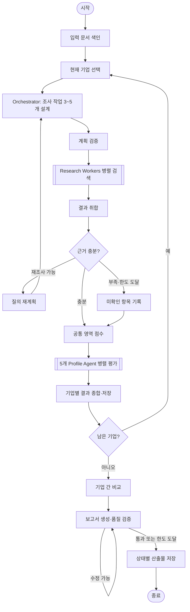

# 배터리 AI 스타트업 투자평가 Agentic RAG

SKALA 4기 울산 3반 4조 · 김대훈, 강도희, 이연주, 정수민, 손연우

배터리 AI 기업의 공개 문서를 검색하고, LangGraph의 Orchestrator–Workers 흐름으로 근거를 수집한 뒤 다섯 가지 투자 관점에서 비교하는 프로젝트입니다. 결과는 투자 결정을 자동으로 확정하지 않으며, 확인되지 않은 내용은 추가 실사 대상으로 남깁니다.

## 처리 흐름



Orchestrator는 기업별 `ResearchTask`를 만들고, `Send`로 작업 수만큼 Worker를 실행합니다. Worker 결과는 reducer로 모은 뒤 `synthesize_research`에서 정렬·중복 제거·실패 집계를 수행합니다. 근거가 부족하면 최대 2회 재계획하고, 이후에도 부족한 항목은 미확인으로 기록합니다. 공통 점수와 검증된 근거는 5개 Profile Agent에 병렬 전달됩니다.

## 주요 구성 요소

| 위치 | 역할 |
|---|---|
| `src/graph.py` | 노드 연결, 조건부 분기, 병렬 fan-out, 기업·보고서 반복 |
| `src/nodes/core.py` | 조사 계획, Worker, 근거 검증, 점수·보고서 처리 |
| `src/schemas.py` | 기업·근거·결과 모델과 LangGraph State |
| `src/agents/profiles/` | 기술·안정·성장·균형·사업성 관점 평가 |
| `src/rag/` | 문서 청킹, 임베딩, FAISS 검색 |
| `src/report_generator.py` | ReportLab 기반 A4 10쪽 PDF 생성 |
| `configs/profiles.yaml` | 프로필별 평가 가중치 |
| `configs/contributors.yaml` | 팀원별 담당 영역 |

State에는 `run_id`, `status`, `plan_version`, 재시도 횟수 같은 제어 값과 `research_tasks`, `research_results`, `validated_evidence`, `profile_results` 같은 작업 데이터가 분리되어 있습니다. SQLite 체크포인트를 이용해 중단된 실행을 같은 `run_id`로 재개할 수 있습니다.

## 팀원별 담당

| 팀원 | 담당 관점 | 주요 검증 영역 |
|---|---|---|
| 손연우 | 기술중심형 | 모델 성능, BMS/ESS 연동, 기술 근거 |
| 강도희 | 안정형 | 안전·규제·재무 리스크 |
| 김대훈 | 성장형 | 시장·고객 확대와 확장성 |
| 이연주 | 균형형 | 근거 편향, 영역 간 균형, 품질 평가 |
| 정수민 | 사업성중심형·통합 | 사업모델, 그래프 통합, PDF 생성 |

기존 PR·커밋과 현재 담당 범위는 [CONTRIBUTORS.md](CONTRIBUTORS.md)에 구분해 기록했습니다. 역할표는 현재 브랜치의 GitHub 기여 기록을 대신하지 않습니다.

## 설치와 실행

Python 3.12 이상과 `uv`가 필요합니다. 저장소 루트에서 의존성을 설치하고 `.env_example`을 `.env`로 복사한 뒤 OpenAI·Tavily·LangSmith 키를 입력합니다. `.env`는 Git에 포함되지 않습니다.

```bash
uv sync
cp .env_example .env
uv run python test_env.py
uv run python main.py
```

`main.py`는 입력 문서를 `data/raw/`에서 읽습니다. 기존 파일이 있을 때 새 파일 선택에 동의하면 폴더의 기존 파일을 삭제하고 교체하므로, 유지하려면 선택 창에서 `n`을 입력하세요. 실행 중 표시되는 ID를 사용하면 `uv run python main.py --resume RUN_ID`로 재개할 수 있습니다.

LangSmith 트레이싱을 켠 경우 프로젝트 `SKALA`에서 `LangGraph` 실행과 하위 Orchestrator·Worker·Profile Agent 호출을 확인할 수 있습니다.

## 보고서와 품질 기준

보고서 검증은 근거 ID 연결, 단정적 기술 우열 표현, 기업별 독립 원본 문서 수를 확인합니다. 미달하면 최대 2회 재생성한 뒤 상태를 명시합니다.

- 통과: `output/report.pdf`에 A4 10쪽 보고서 생성
- 미통과: `output/final_multi_agent_report.md`에 검토용 초안 저장, 새 PDF는 생성하지 않음
- 레이아웃 확인: `output/pdf/report-layout-preview.pdf`는 합성 데이터로 만든 미리보기이며 실제 평가 결과가 아님

PDF는 표지, 핵심 요약, 평가 방법, 기업 비교, 기업별 분석 3쪽, 담당 관점, 근거 품질, 추가 실사·출처 순서로 구성됩니다. 이전 실행의 PDF가 남아 있을 수 있으므로 현재 실행의 상태와 생성 시각을 함께 확인해야 합니다.

## 현재 한계

- `score_common`의 영역 점수에는 고정값이 포함되어 있어 실투자 판단에 사용할 수 없습니다.
- 보고서 검증은 규칙 기반이며 문장별 사실성을 판정하는 LLM 평가기는 없습니다.
- 현재 로컬 입력 문서는 ACCURE 자료 1개입니다. 다른 기업의 독립 원본 자료가 부족하면 최종 PDF 품질 기준을 통과하지 못합니다.
- 검색 결과의 기업별 출처 분리를 추가 검증해야 합니다. 한 기업의 문서가 다른 기업 평가에 섞이지 않도록 근거 ID와 원본 문서를 확인하세요.

## 테스트

```bash
uv run python -m unittest discover -s tests -v
```
