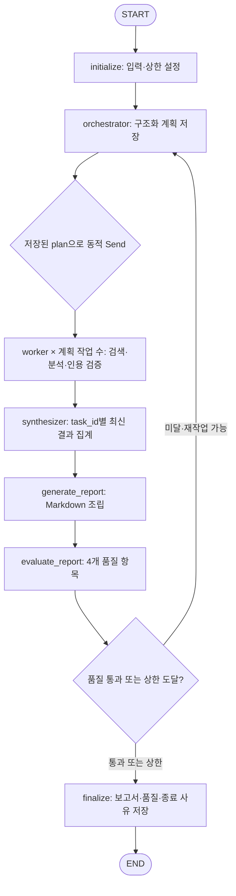

# 배터리 AI 스타트업 다관점 평가 — Orchestrator-Workers

SKALA 4기 · 울산 3반 · 4조. 배터리 AI 스타트업의 공개 문서를 RAG로 검색하고, **기술 성숙도·시장성·이해관계자·도메인 적용**의 네 관점에서 근거와 한계를 정리하는 LangGraph 프로젝트입니다. 보고서는 `SUMMARY`, 기업별 관점 분석, `REFERENCE`로 구성하며 투자 추천·순위·우열 점수를 만들지 않습니다.

## Overview

- **목적:** 기업마다 다른 기술·적용 영역을 조사하고, 확인 내용과 상충 근거·미확인 사항을 함께 제시합니다.
- **패턴:** Orchestrator가 구조화된 조사 계획을 먼저 저장하고, 계획에 따른 Worker를 병렬 실행한 뒤 Synthesizer가 집계합니다. 적용 분야가 여러 개면 작업을 분할하여 기업마다 작업 수가 달라집니다.
- **선정 이유와 trade-off:** 조사 항목이 실행 시 결정되는 보고서 작업에 적합합니다. 병렬 조사로 시간을 줄이지만 LLM 계획·품질 판정의 변동성과 호출 비용이 늘어납니다. 계획·인용 검증, 결정 로그, 재시도 상한으로 실행을 추적합니다.
- **동적 처리:** 네 관점은 필수 커버리지이고, Worker의 개수와 질문은 `ResearchPlan`으로 결정됩니다. `Send`는 저장된 `plan`을 순회합니다. API 없는 데모도 허구 회사 A에 5개, B에 4개의 작업을 생성합니다.

패턴 참고: [LangGraph 공식 Workflows and agents 문서](https://docs.langchain.com/oss/python/langgraph/workflows-agents).

## Selected Companies

기본 live 대상은 기존 자료 풀과 연결되는 아래 세 기업입니다. `--company`로 다른 대상을 지정할 수 있으나, 해당 기업의 입력 문서도 필요합니다.

| 기업 | 조사 범위 |
|---|---|
| ACCURE | BESS·EV 배터리 이상·안전·성능·열화 분석 |
| volytica diagnostics | ESS 운영 데이터 기반 SOH·열화·안전 분석 |
| Electra Vehicles | EV 배터리 디지털 트윈, SOC·SOH 예측 |

## Features and Agents

| 구성 | 책임 |
|---|---|
| Orchestrator | 기업별 질문·검색어·분할 사유를 `ResearchTask`로 계획하고 검증합니다. 모델 계획 실패 시 기업 설명에 따른 4~5개 작업으로 fallback합니다. |
| Workers | 작업별 RAG 검색 → 구조화 분석 → 인용 검증을 수행합니다. 같은 Worker 구현에 네 관점의 작업을 각각 전달합니다. |
| Synthesizer | `task_registry`와 `worker_results`를 회사·관점별로 집계하고 실패·근거 부족 상태를 보존합니다. |
| Report Generator | 주장·직접 인용·원문 위치·미확인 사항을 Markdown으로 조립합니다. |
| Quality Evaluator | 보고서 생성 후 네 품질 항목을 평가하고, 미달 회사·관점을 Orchestrator에 재작업 요청합니다. |

- PDF/TXT를 500자 청크, 50자 overlap으로 처리하고 FAISS에서 검색합니다.
- 주장마다 `evidence_id`, 직접 인용, 파일·페이지·출처 그룹을 연결합니다. 원문에 없는 인용은 해당 주장 전체를 제외합니다.
- 유리한 근거와 함께 한계·상충·미확인 사항을 기록하고, 회사·관점별 인용 출처 그룹을 검사합니다.
- Worker 예외는 기본 최대 2회 시도 후 `failed` 결과로 남깁니다. 다른 Worker는 계속 실행하며, 실패 관점은 품질 평가와 제한된 재작업 루프에 포함됩니다.
- 품질 미달 상태로 상한에 도달해도 결과와 종료 사유를 저장합니다. 해당 실행을 품질 통과로 표시하지 않습니다.

## Tech Stack

| 항목 | 적용 |
|---|---|
| Framework | LangGraph `StateGraph`, 동적 `Send`, SQLite checkpoint |
| LLM / Generator | OpenAI `gpt-4o-mini` 기본값; `--generator-model`로 변경 |
| LLM / Judge | OpenAI `gpt-4o-mini` 기본값; `--judge-model`로 변경 |
| Structured Output | Pydantic 계획·Worker 결과·품질 verdict |
| Retrieval | FAISS; 검색어별 Top-12에서 회사 관련 근거를 선택하고 작업당 최대 15개 보존 |
| Retrieval 평가 | **Hit Rate@K, MRR 미측정** — 정답 근거 데이터셋과 별도 평가가 필요 |
| Embedding | `intfloat/multilingual-e5-base`, 로컬 CPU, 정규화 |
| Reports / Observability | Markdown, PDF, 외부 JSON/JSONL, LangSmith 선택 설정 |

## State Schema

정의: [src/orchestration/schemas.py](src/orchestration/schemas.py). State는 제어 흐름과 재개에 필요한 최신 산출물을 보관합니다.

| 필수 설계 항목 | 구현과 근거 |
|---|---|
| 제어 vs 페이로드 분리 | `trace_id`, `step_count`, `node_status`, `last_error`, 재시도·종료 설정은 제어 메타입니다. `plan`, `task_registry`, `worker_results`, `synthesis`, `report_draft`, `eval_result`는 작업 페이로드입니다. |
| 관측성 위치 | 노드 결정과 사유는 `{trace_id, node, decision, reason, ts}`를 포함한 외부 `decisions.jsonl`에 기록합니다. 계획·평가 이력도 외부 JSON으로 저장합니다. |
| 지속성 비용 | 원문은 `evidence/` 파일로 분리합니다. State에는 짧은 주장·인용·출처 메타와 최신 결과를 보존하며, 회사·작업·목록 길이를 제한합니다. |
| 상관 | 동일한 `trace_id`로 State, 실행 폴더, 결정 로그와 checkpoint의 `thread_id`를 연결합니다. |
| 재개/복구 | SQLite checkpoint가 최신 State와 다음 실행 위치를 저장합니다. `--resume`으로 같은 실행 폴더와 thread를 재개합니다. 원문 파일과 checkpoint가 함께 있어야 합니다. |
| 동시 처리 | 병렬 Worker는 `worker_results`만 갱신합니다. `task_id`를 키로 사용하는 reducer가 결과를 upsert하여 재실행 결과가 중복 누적되지 않습니다. `task_registry`도 같은 병합 방식을 사용합니다. |
| 종료 보장 | 기업 최대 5개, 기업별 작업 최대 8개, 관점별 최대 2개입니다. 품질 재작업은 기본 2회(허용 0~3), Worker 시도는 기본 2회(허용 1~3), 제어 단계 상한 기본 30으로 제한합니다. |

`ResearchTask`는 `task_id`, `company_name`, `perspective`, `question`, `queries`, `rationale`을 가집니다. `plan`은 이번 실행 대상으로, `task_registry`는 최초 및 재작업 대상의 전체 목록으로 사용합니다. `worker_results[task_id]`는 최신 결과를 유지합니다.

## Report Quality

| 항목 | 검사 |
|---|---|
| Groundedness | 주장·근거 ID·원문 인용·본문·REFERENCE 연결을 확인합니다. hybrid에서는 주장 의미가 인용 문맥으로 지지되는지도 Judge가 평가합니다. |
| 중립성 | 투자 추천·기업/기술 우열 표현을 검사하고, hybrid에서는 문맥도 평가합니다. |
| 편향 통제 | 회사·관점별 최소 2개 인용 출처 그룹과 한계·상충·미확인 또는 출처 제한을 확인합니다. |
| 관점 커버리지 | 모든 회사의 네 관점에 완료 Worker의 유효 인용 주장이 있어야 합니다. 미확인 항목만으로 통과하지 않습니다. |

live의 기본 `hybrid`는 결정적 검사와 LLM Judge를 **모두** 통과해야 합니다. Judge 호출이 실패하면 품질 미달로 처리합니다. `--quality-mode deterministic`은 정적 검사만 수행하며, 데모는 이 모드로 고정됩니다. 인용 substring 일치는 인용의 실재 여부를 확인하는 검사로, 주장 의미나 사실의 진실성을 보장하지 않습니다.

출처 그룹은 publisher/명시적 metadata 그룹, 원출처 URL의 hostname, 파일명 순으로 구성합니다. publisher·URL이 없는 파일 단위 그룹은 **대리지표이며 독립 출처를 보장하지 않습니다**. 하나의 파일에 여러 원출처가 섞이거나 같은 발행자가 여러 파일을 만들면 그룹 판정에 한계가 있습니다. 실제 독립성은 추가 검증 대상입니다.

## Architecture



## Directory Structure

```text
main.py                       Orchestrator-Workers CLI
legacy_main.py                기존 투자평가 실행 경로
src/orchestration/
  schemas.py                  계획·결과·State·reducer
  planner.py                  계획 생성·검증·fallback
  worker.py / evidence.py     관점별 RAG 분석·인용 검증
  reporting.py / quality.py   집계·보고서·품질 판정
  finalize.py / pdf_report.py 최종 산출물·10쪽 이내 PDF
  observability.py / demo.py  외부 로그·API 없는 허구 fixture
  checkpoints.py              State 모델 복원 allowlist
src/graph.py                  동적 fan-out·재작업·종료
src/cli.py                    CLI·SQLite 체크포인트 재개
src/rag/                      기존 문서 ingest·E5·FAISS
configs/                      기존 투자 프로필·루브릭
data/raw/                     입력 PDF/TXT
data/processed/faiss_index/   검색 인덱스
output/runs/<trace_id>/        실행별 보고서·근거·checkpoint
tests/                        패턴·품질·실패 처리 검증
```

## Usage

Python 3.12 이상과 `uv`를 사용합니다.

```bash
uv sync
uv run python main.py --demo
```

데모는 모델 API 키·임베딩 다운로드·실제 문서 검색 없이 허구 회사 두 곳을 조사합니다. 기본 데모는 LangSmith 전송도 비활성화합니다. 회사·기관·문서·수치는 모두 교육용이며 실제 기업 평가 결과가 아닙니다. PDF를 생략하거나 실행 폴더를 지정할 수 있습니다.

```bash
uv run python main.py --demo --no-pdf --output-dir output/runs/demo
```

실제 자료를 평가하려면 `.env.example`을 `.env`로 복사해 `OPENAI_API_KEY`를 설정하고 `data/raw/`에 PDF/TXT를 넣습니다. 첫 실행은 문서 ingest와 임베딩 모델 다운로드가 필요합니다. 파일명에 ACCURE, volytica, Electra가 있으면 기업 metadata로 연결하며, 그 밖의 자료는 청크에 기업명이 있는지 확인합니다.

```bash
cp -n .env.example .env
uv run python main.py
uv run python main.py --company ACCURE --company "Electra Vehicles" --domain "배터리 AI"
uv run python main.py --skip-ingest --no-pdf --quality-mode hybrid \
  --max-quality-retries 2 --max-worker-attempts 2 \
  --generator-model gpt-4o-mini --judge-model gpt-4o-mini
uv run python main.py --resume output/runs/demo
```

`--skip-ingest`는 이미 생성된 로컬 FAISS 인덱스를 사용합니다. `--resume`은 실행 폴더의 `checkpoint.sqlite`와 같은 thread를 사용하며 원문·계획 파일을 함께 유지해야 합니다. 실행별 주요 산출물은 다음과 같습니다.

계획 저장 후 중단·재개를 확인하려면 다음 명령을 사용합니다. 기존 출력 폴더는 덮어쓰지 않습니다.

```bash
uv run python main.py --demo --no-pdf --pause-before-workers --output-dir output/runs/resume-demo
uv run python main.py --resume output/runs/resume-demo
uv run python -m unittest discover -s tests -p test_orchestrator_workers.py -v
```

```text
report.md / report.pdf      SUMMARY·기업별 관점·REFERENCE 보고서
plan-r<N>.json             최초/재작업 계획
quality-r<N>.json          revision별 품질 판정
quality-final.json         최종 품질 판정
evidence/                  작업별 검색 원문
decisions.jsonl            결정·분기 사유
final-state.json           종료 사유를 포함한 최종 State
checkpoint.sqlite          동일 thread 재개 상태
```

PDF는 최대 10쪽의 요약 보고서로 출력하고 상세 내용은 Markdown과 원문 파일로 확인합니다. `--no-pdf`를 사용하면 Markdown과 실행 증거만 생성합니다.

PDF의 한국어 글꼴은 macOS AppleGothic, Linux NanumGothic, Windows 맑은 고딕을 탐색합니다. 별도 글꼴은 `REPORT_FONT_PATH`로 지정할 수 있습니다.

기존 구현은 `uv run python legacy_main.py`로 실행할 수 있습니다. 이 경로는 고정 5프로필 투자평가와 임시 공통 점수를 포함하며, 새 과제의 동적 계획·네 관점·보고서 품질 루프를 충족하는 기본 경로가 아닙니다.
기존 PDF 경로의 WeasyPrint는 Pango/GLib 시스템 라이브러리도 필요합니다. 새 PDF 경로는 ReportLab을 사용합니다.

## LangSmith and Submission

`.env`의 `LANGSMITH_TRACING=true`, `LANGSMITH_API_KEY`, `LANGSMITH_PROJECT`를 설정하면 LangSmith tracing을 활성화합니다. 기존 `LANGCHAIN_TRACING_V2`, `LANGCHAIN_API_KEY`, `LANGCHAIN_PROJECT` 환경 이름도 호환합니다. 실행 `trace_id`로 로컬 결정 로그와 비교합니다.

데모의 동적 분할을 LangSmith에서 확인하려면 `--trace`를 명시합니다. 모델 호출은 하지 않고 허구 실행의 그래프 trace만 전송합니다.

```bash
uv run python main.py --demo --trace --no-pdf
# 프로젝트를 직접 지정하려면:
uv run python main.py --demo --trace --trace-project SKALA --no-pdf
```

터미널에 출력되는 프로젝트에서 `battery-orchestrator-workers` 실행을 열면 하위 `orchestrator`, `worker`, `synthesizer` 노드를 볼 수 있습니다. 종료 전에 explicit Client를 flush하고, 서버에서 해당 run을 읽은 후 trace 링크를 표시합니다. 조회 결과는 실행 폴더의 `langsmith-trace.json`에 기록하며, `uploaded: false`이면 전송 또는 서버 조회가 확인되지 않은 상태입니다. 완료된 실행을 `--resume`하는 경우 그래프가 다시 실행되지 않으므로 새 trace는 생성되지 않습니다.

제출에는 작업 브랜치의 GitHub 링크, 동적 fan-out과 품질 재작업을 확인할 수 있는 `tracing-1.png`, `tracing-2.png` 등 LangSmith 캡처, 최대 10쪽 PDF가 필요합니다. 허구 데모의 trace를 SKALA 프로젝트에 전송하고 서버에서 `orchestrator` 1개·`worker` 9개를 확인했습니다. 제출용 캡처는 별도로 준비해야 하며, 실제 문서·LLM 기반 live 실행과 Retrieval Hit Rate/MRR은 아직 검증·측정하지 않았습니다.

## Contributors

아래 역할은 기존 [configs/profiles.yaml](configs/profiles.yaml)에 명시된 담당 기준입니다. 새 Orchestrator-Workers 기능의 개인별 수행 역할은 실제 담당 내역 확인 후 제출 전에 보완해야 합니다.

- 손연우: 기술중심형 투자 프로필
- 강도희: 안정형 투자 프로필
- 김대훈: 성장형 투자 프로필
- 이연주: 균형형 투자 프로필
- 정수민: 사업성중심형 투자 프로필
